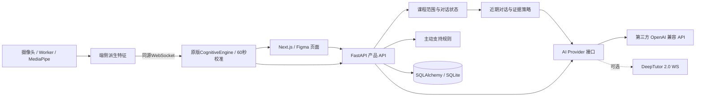

# AI 学习助手

基于你的 Figma 与 PRD V0.3 实现的模块化本地开发项目。首版聚焦三套短任务的学习闭环，保留后续接入第三方 AI 的边界。

**默认没有连接任何 AI，也不生成模拟回复。** 开场、题目、提示、示范和后续追问均由真实模型生成；未配置时展示连接入口。三套课程只固定课题范围与学习目标，不再固定话术或强制六步顺序。

## 启动

需要 Node.js 22.12+（推荐 24 LTS）、Python 3.11–3.13。当前在 macOS / Python 3.12 验证。

```bash
git clone https://github.com/fft020205/ai-study.git
cd ai-study
npm ci
python3.12 -m venv .venv
.venv/bin/python -m pip install -r services/api/requirements.lock.txt
cp .env.example .env
npm run assets:vision
npm run dev
```

若本机只有 `python3`，先确认版本，再替换 `python3.12`。如果目录中已经有可用的 `.venv`、`node_modules` 和视觉资源，可以直接 `npm run dev`。

- 页面：<http://localhost:3000>
- API 交互文档：<http://127.0.0.1:18000/docs>
- API 合同快照：[docs/api/openapi.json](docs/api/openapi.json)
- 两个服务默认只监听本机。停止时在启动终端按 Ctrl+C。
- 数据库自动在 `data/study.db` 建立。访客记录属于当前浏览器 Cookie，清掉 Cookie 后不会自动恢复身份。

## 连接第三方 AI

直接打开 <http://127.0.0.1:3000/settings/ai>，或从右上角访客菜单打开“AI 接口设置”。填写 API 地址、密钥和模型名，点击“保存并生效”即可，无需重启。支持 OpenAI 兼容的 Chat Completions 协议；地址既可填 Base URL，也可粘贴完整 `/chat/completions` 地址。

“测试连接”测试当前填写的配置，不保存；会调用一次模型并可能产生少量费用。进入课程时生成开场、发送文字、请求提示/示范/换例子，以及已开启的主动支持都会调用模型。保存配置不会调用。

密钥只保存在本机后端的 `data/ai-connection.json`（权限600），页面不回显、不写浏览器存储。配置文件重启后自动读取，优先于 `.env` 的 AI 配置；停用在设置页选择“暂不启用”并保存。设置接口只接受本机请求。完整行为见 [11-ai-settings.md](docs/modules/11-ai-settings.md)。

也可在首次未使用页面保存配置时，通过根目录 `.env` 配置并重启：

```dotenv
AI_PROVIDER=openai
AI_BASE_URL=https://你的服务地址/v1
AI_API_KEY=你的密钥
AI_MODEL=你的模型名
```

支持 OpenAI 兼容的 `POST /chat/completions`，需要 JSON 输出。密钥只在 Python 后端使用。文字回答通常分为一次内部核对与一次可见回复；开场及按钮动作通常一次生成，费用按实际调用计。没有密钥时返回明确的503，页面保留未发送消息并提供重试。

如果服务商协议不同，替换 `services/api/study/ai.py` 的 Provider，不需要改 UI。详细输入输出、超时、取消与示例见 [AI 接口模块](docs/modules/04-ai-interface.md)。DeepTutor 2.0 WebSocket 适配器已保留，但没有下载/运行 DeepTutor 或配置其模型；上游在线联调属于接入后的工作。

## 首版完成范围

| 可使用 | 边界 |
|---|---|
| Figma 任务选择、开始前设置、对话、学习设置、结束回顾、隐私页 | 白色与浅绿设计、原始 SVG、Noto Sans SC；没有另造仪表盘 |
| 变量、平均数、因果三套课题 | 模型在课题范围内结合近期对话自由解释、追问和出题 |
| 动态提示、完整示范、换例子与练习记录 | 不把看过答案或换题计为独立完成 |
| 自述与答题证据驱动的语气调整 | 认知、效价和压力分开；未知保留；用户纠正优先；不假装摄像头测出了情绪 |
| 主动支持规则 | 发现有效卡点/负荷/疲劳或等待30秒后生成；整次学习不限总量，每轮最多3种状态，原卡保留并自适应更新 |
| 摄像头与原仓库视觉判定 | 开启后先完成60秒有效校准，再自动进入AI对话；约2Hz WS、原版引擎、后台停采 |
| 琥珀色疲劳/负荷提醒 | 自述与暂定视觉线索分开标注；真实LLM结合当前状态判断，纠正和过期优先 |
| 历史、导出、删除、访客资源隔离 | 本机 SQLite；PostgreSQL 连接可配置，但该路径尚未实测 |

未实现/不显示：语音输入、声学情绪、视觉情绪分类、多模态融合、实验 A/B、研究问卷、任意教材上传与 RAG、账户登录和多人部署。首版不是原 PRD 的完整三模态 P0。视觉行为摘要已进入每次真实模型调用的上下文；视觉/声学情绪分类仍不可用。

## 架构与模块文档



视觉实际接入、WebSocket合同和LLM状态链路见 [13-visual-analysis.md](docs/modules/13-visual-analysis.md)。原始视频和关键点留在浏览器；派生特征仅在本机后端内存处理，最新摘要随模型请求交给配置的服务商。原引擎是启发式行为估计，提醒采用暂定语气。

自适应对话的修改入口见 [12-adaptive-dialogue.md](docs/modules/12-adaptive-dialogue.md)。完整索引见 [模块开发索引](docs/DEVELOPMENT.md)。每个模块都有职责、文件、接口、修改步骤、验证方式和已知限制。

## 验证

```bash
npm test
npm run build
```

浏览器复核记录与已验证边界见 [验收记录](docs/VERIFICATION.md)。测试里的模拟服务只属于 `tests/`，产品运行路径不会引用它们。

后续 AI 工具请先读根目录 [AGENTS.md](AGENTS.md)，再阅读所修改模块的 `.md`。不要把文档里的未来方案误认为当前已实现功能。

历史记录按课程自动命名为“平均数01”“平均数02”等，删除后编号继续递增，旧默认记录补号并保留手动名称；每条可通过更多菜单重命名或删除，名称保存在本机后端，刷新后保留；具体接口和修改入口见[14-session-history.md](docs/modules/14-session-history.md)。

消息发送现采用即时用户气泡、思考动画与真实SSE增量；普通回复不附带固定建议按钮。消息与重试、模型流式兼容和按需提示规则见[15-streaming-dialogue.md](docs/modules/15-streaming-dialogue.md)。

开启摄像头的课程先显示校准准备页，有效画面累计60秒且基线充分后才自动生成AI开场；不启用摄像头可直接文字学习。断线/重开重新准备，重试/关闭入口和已发文字保留。当前不持久保存个人基线，复用可行性与模块修改入口见 [16-lesson-preparation.md](docs/modules/16-lesson-preparation.md)。

## 中英文界面与 AI 对话

右上角语言选择器支持简体中文与英文，偏好在当前浏览器保存。新会话及后续真实AI生成（包括支持卡片）跟随当前语言；已保存对话保留原文。正在输出的回复继续完成，切换不重置摄像头或校准。传输、并发和其他AI工具的修改入口见[17-dialogue-language.md](docs/modules/17-dialogue-language.md)。
