# 英文 UI 全尺寸布局排查报告

日期：2026-11-03（Asia/Shanghai）

## 结论

- 共确认并修复 **7 类布局问题**：**阻断性 1 类、一般性 6 类、优化项 0 类**。
- 用户已指出的“开始新的学习”按钮问题已复现并修复；用户同时选中的语言选择器在已测环境中未复现裁切，未进行无依据修改。
- 修复后完成 18 种视口的主矩阵 **229 条扫描记录**，以及生产组件补测与交互矩阵 **97 条扫描/交互记录**。补测未发现文本或控件横向溢出；主矩阵剩余的 64 条原始重叠候选经截图、裁切祖先、hit-test 或实际点击复核，均为导航遮罩、账户弹层或局部滚动区域的预期表现，不是 64 个新增缺陷。
- 最终 `npm test` 通过：后端 **173 项**、前端 **12 个文件共 46 项**、TypeScript 检查通过；`npm run build` 通过。
- 临时补测路由已删除，最终构建仅包含 `/`、`/_not-found`、`/settings/ai`；运行中的首页和 `/api/health` 返回 200，`/layout-audit?state=messages` 返回 404。

## 范围与方法

覆盖首页任务选择、课程设置、学习空状态与消息、全局 Notice、摄像头关闭及视觉准备/校准/警告状态、结束总结、历史重命名与删除、隐私页、独立 AI 设置页、账户菜单、移动抽屉和通用 Dialog。补测使用生产 `Shell`、`Dialog`、`Conversation`、`Composer` 与视觉状态组件。

浏览器为本机 **Google Chrome 156.0.8078.80（无头模式）**，通过 Playwright 检查元素宽度、文本 Range、视口边界、局部滚动、整页宽度、hit-test、键盘焦点及真实点击。截图不能单独作为结论，几何候选均需结合裁切上下文复核。

验收视口：

```text
1920×1080, 1440×900, 1366×768, 1280×720,
1200×800, 1199×800, 1024×768, 820×1180,
768×1024, 767×1024, 430×932, 390×844,
375×667, 360×800, 320×568,
844×390, 667×375, 568×320
```

## 问题总表

| ID | 严重程度 | 页面/组件 | 问题 | 状态 |
|---|---|---|---|---|
| L-01 | 阻断性 | 移动导航抽屉 | 矮横屏下隐私入口位于视口外且抽屉不能滚动，入口不可达 | 已修复并实际进入隐私页 |
| L-02 | 一般性 | 桌面“开始新的学习”按钮 | 英文内容超出固定宽度按钮 | 已修复，文本完整 |
| L-03 | 一般性 | 移动端摄像头重开按钮 | 图标与英文内容越出按钮边界 | 已修复，320px 下完整 |
| L-04 | 一般性 | 历史重命名 Dialog | 长 URL 错误文本撑出弹窗 | 已修复，局部断行 |
| L-05 | 一般性 | 全局 Notice | 长 URL 错误文本造成水平溢出 | 已修复，局部断行 |
| L-06 | 一般性 | Markdown 消息表格 | 六列表格在窄屏被逐字挤压，表头不可读 | 已修复，局部横向滚动且支持键盘 |
| L-07 | 一般性 | 通用 Dialog | 矮横屏下顶部越界，内容不能内部滚动，底部操作难以到达 | 已修复，滚动、关闭和焦点恢复通过 |

## L-01 · 阻断性：矮横屏移动抽屉入口不可达

- **页面/视口**：移动导航抽屉，568×320。
- **重现**：英文界面打开导航；观察底部“Privacy and data information”；尝试滚动并点击。
- **修复前**：抽屉 `clientHeight=320`、`scrollHeight=394`、`overflow-y=visible`；隐私入口顶部为 330px，位于 320px 视口之外，`scrollIntoView()` 后 `scrollTop` 仍为 0，hit-test 失败。
- **根因**：抽屉没有自己的纵向滚动约束，内容高度超出矮视口后无法把底部操作带入可视区。
- **修复**：在 `app/styles.css` 为 `.sidebar.open` 增加 `overflow-y:auto` 与 `overscroll-behavior:contain`，保留既有宽度和移动断点。
- **修复后**：同一视口中抽屉可滚动，隐私入口滚动后 `scrollTop=94`、hit-test 通过；已实际点击并打开“Privacy & Data”页面。

修复前：

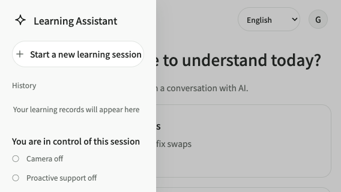

修复后：

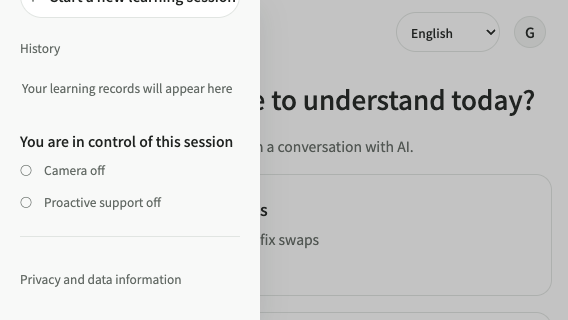

## L-02 · 一般性：桌面新学习按钮英文溢出

- **页面/视口**：完整侧栏，≥1200px；定量证据取自 1440×900。
- **重现**：切换英文，在完整侧栏查看“Start a new learning session”。
- **修复前**：按钮边界为 `left=20, right=220, width=200`，内容 Range 为 `left=13.97, right=226.05, width=212.08`，左右均越界。
- **根因**：固定 200px 宽度配合不换行及原有行高，无法容纳英文文案与图标。
- **修复**：`.new-learning` 保留 200px 宽度，改为 `white-space:normal`，并调整行高、垂直 padding、字号和间距；移动抽屉继续使用完整的单行按钮。
- **修复后**：主矩阵未再发现该文本溢出，按钮文案完整显示。

修复前：


修复后：

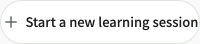

## L-03 · 一般性：移动摄像头重开按钮内容越界

- **页面/视口**：摄像头关闭卡片，≤767px；定量证据取自 320×568。
- **重现**：在学习页关闭摄像头，查看“Turn on camera”按钮。
- **修复前**：320px 下内容 Range 约为 `left=204.36, right=311.66, width=107.30`，超出按钮自身边界。
- **根因**：窄屏按钮仍使用较大的字号、间距与水平 padding。
- **修复**：仅在既有移动媒体查询中调整 `.camera-reopen` 的字号、padding 和间距，不改变摄像头状态、拖动或媒体生命周期。
- **修复后**：320px 截图中图标和完整英文均位于按钮内，主矩阵未再发现内容越界。

修复前：

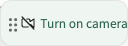

修复后：

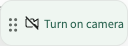

## L-04 · 一般性：历史重命名长错误文本溢出

- **页面/视口**：历史记录“Rename learning record”Dialog，320×568。
- **重现**：输入合法名称；在保存失败且错误中含无空格长 URL 时查看错误区域。
- **修复前**：长 URL 不支持在任意位置断行，造成约 624px 的水平内容溢出。
- **根因**：`.history-error` 缺少长令牌断行策略。
- **修复**：为 `.history-error` 增加 `overflow-wrap:anywhere`，仅影响错误显示，不修改后端错误原文。
- **修复后**：错误在弹窗阅读宽度内换行，保存/取消按钮保持可达，主矩阵未再发现该类溢出。

修复前：

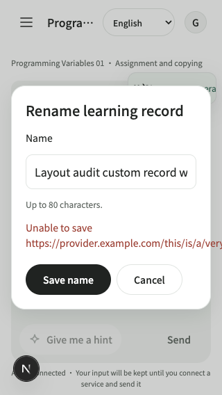

修复后：

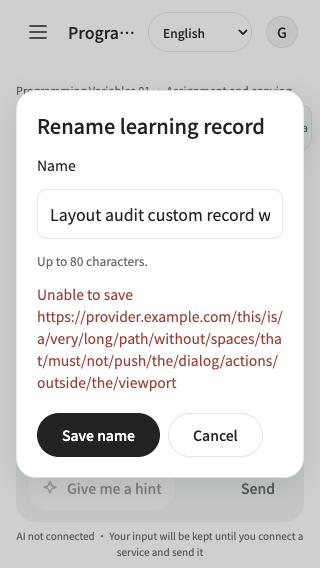

## L-05 · 一般性：全局 Notice 长 URL 溢出

- **页面/视口**：学习页全局 Notice，320×568 与 568×320 等窄视口。
- **重现**：显示包含无空格长 URL 的操作失败提示。
- **修复前**：长 URL 将内容撑出提示区域，最大测得约 324px 的元素水平溢出。
- **根因**：`.notice` 缺少长令牌断行策略。
- **修复**：为 `.notice` 增加 `overflow-wrap:anywhere`，保留原关闭操作和视觉样式。
- **修复后**：长 URL 在提示区域内断行，整页宽度等于视口宽度，未再发现该类严重扫描项。

修复前：

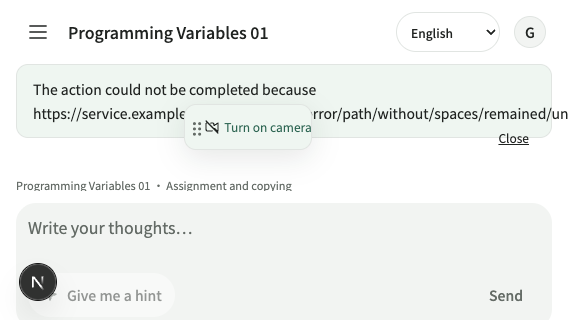

修复后：

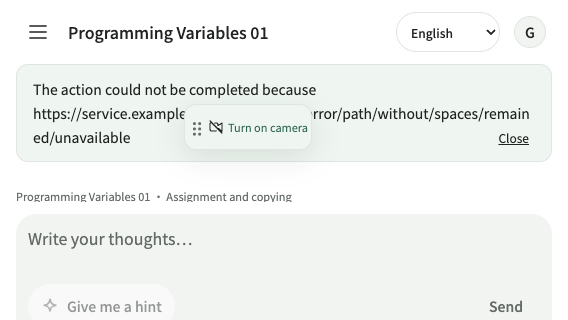

## L-06 · 一般性：窄屏 Markdown 表格逐字挤压

- **页面/视口**：普通回复、流式回复及主动支持卡片的 Markdown 表格，320×568。
- **重现**：渲染包含六个英文表头及长单元格的 GFM 表格。
- **修复前**：六列被强制压入消息宽度，表头拆成单字母纵排；虽然没有整页横向滚动，但内容不可读。
- **根因**：全局长文本 `overflow-wrap:anywhere` 同时作用于表格，且表格没有独立横向滚动容器。
- **修复**：`Conversation.tsx` 使用共享 Markdown 组件映射，把表格包装为 `.table-scroll`；容器具有 `role="region"`、中英文无障碍名称和 `tabIndex={0}`。CSS 仅令该容器 `overflow-x:auto`，表格恢复 `overflow-wrap:normal`，并增加 `:focus-visible` 样式。原始回复文本、GFM、链接安全属性和图片禁用策略不变。
- **修复后**：320px 下局部最大横向滚动范围为 902px；真实 Tab 可聚焦区域，方向键使 `scrollLeft` 从 0 增至 240，随后可滚到 902；整页宽度仍为 320px。英文区域名为“Scrollable table”。表头按单词形成 1–3 行，不再逐字母纵排。
- **自动化**：`Conversation.test.tsx` 新增语义结构回归，验证表格、区域名称、键盘焦点入口及单元格内容。

修复前：

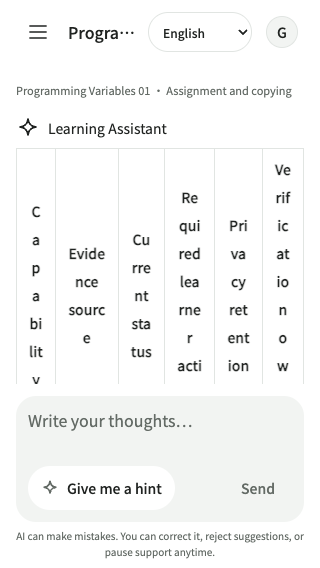

修复后：

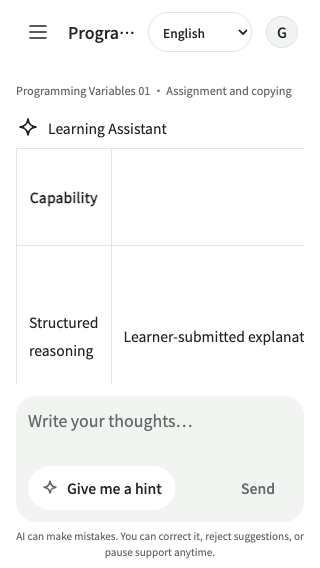

局部滚动后：

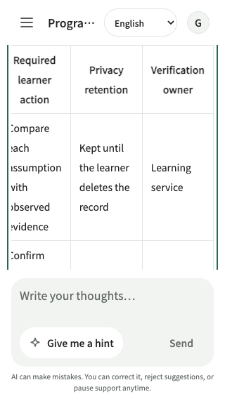

## L-07 · 一般性：矮横屏 Dialog 顶部及操作不可达

- **页面/视口**：通用 Dialog，568×320。
- **重现**：打开含长纠正文本和底部操作的弹窗，检查标题、文本区及操作按钮。
- **修复前**：弹窗约为 `y=-10, height=340, bottom=330`，顶部越出视口，`overflow-y=visible`，不能通过内部滚动可靠到达全部内容。
- **根因**：弹窗只有宽度约束，没有相对动态视口高度的最大高度和纵向滚动。
- **修复**：`.modal` 增加 `max-height:calc(100dvh - 32px)`、`overflow-y:auto` 和 `overscroll-behavior:contain`，保留既有宽度、焦点圈和 Escape 行为。
- **修复后**：弹窗顶部位于视口内，内部滚动范围为 52px；底部 Back 可实际点击并关闭，Escape 也可关闭。Shift+Tab/Tab 焦点循环通过，两种关闭方式均把焦点恢复到打开按钮。临时补测 fixture 的按钮问题已修正，不将其误记为产品缺陷。

修复前：

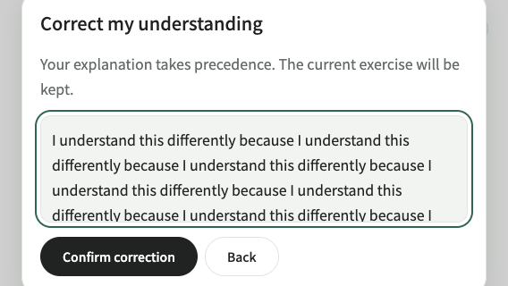

修复后：

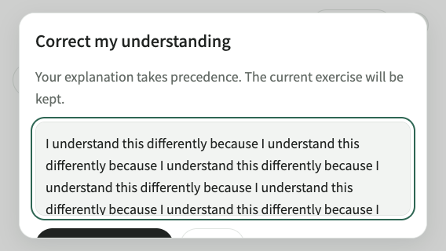

## 用户选中的语言选择器

共享 `LanguageSwitcher` 已在上述 18 种视口及主 Shell、独立 `/settings/ai` 使用位置检查。当前 Chrome 环境中“English”文本和原生下拉箭头完整，未复现文本裁切、横向越界或整页溢出，因此未修改其样式，也不将其计为已修复问题。若异常仅在特定浏览器、系统字体或缩放级别出现，仍需按该环境补充复现。

## 回归与边界

- 主矩阵修复后没有文本溢出、控件横向越界等严重扫描项。64 条 `interactive-overlap` 原始候选已按上下文复核：导航 scrim 和账户菜单是有意覆盖；学习空状态与 Composer 的原始矩形重叠来自 `.conversation-viewport` 滚动裁切。账户菜单隐私入口已实际点击；空状态操作滚动后 `scrollTop=148` 且 hit-test 通过。
- 补测矩阵共 97 条记录，没有扫描 findings；覆盖表格键盘操作、Dialog 滚动/焦点/关闭、移动抽屉、账户菜单和空状态操作可达性。
- `npm test`：后端 173 项通过，有 1 条既有 Starlette/anyio 弃用警告；前端 12 个文件 46 项通过；TypeScript 通过。
- `npm run build`：Next.js 16.4.3 生产构建通过，仅含正式路由。临时 `/layout-audit` 已删除并确认 404。
- 测试使用独立英文浏览器访客上下文及测试学习记录，结束后清理。未调用真实模型、未保存真实 AI 配置、未开启实体摄像头；视觉状态为不连接设备的生产组件补测，不代表视觉算法或硬件验证。
- 未执行 Safari、Firefox、实体移动设备、系统字体/缩放全矩阵、真实摄像头硬件或完整辅助技术审计。视口模拟、键盘回归和截图不能替代这些验证。
