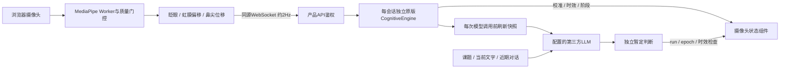

# 13 · 原仓库视觉引擎与实时模型通信

## 目标与实际接入

用户指定仓库：https://github.com/rajatmurhe/adaptive-cognitive-load-analysis 。已固定提交0c938e4fec21a852401c10213127a630d0b6cf75，实际加载其backend/cognitive_engine.py的CognitiveEngine，保留原文，不是重写的占位算法。源码、来源与SHA-256在integrations/adaptive-cognitive-load-analysis/upstream.lock.json；启动时校验，不匹配则关闭该能力并返回明确不可用。

端侧behaviorFeatures.ts按上游web/app.js的几何特征路线实现TypeScript版本，EAR使用像素坐标修正宽高比。只加载计算核心，不运行上游带公开CORS、CSV/PDF和外部服务地址的完整服务器。原核心仅依赖Python标准库，无需额外安装机器学习包。

上游没有声明许可证；保留来源并供用户要求的本地集成使用，不声称具有再分发或商业授权。对外分发前需解决许可。此处不把启发式指数当作经过效度验证的测量模型。

## 数据流与模块边界



视频、图片、人脸关键点只在浏览器内。后端收到三个数值特征及质量/时间，不接收原始影像。摘要包括特征、原阶段、基线比值与有效性，随教学请求给配置的AI；没有每帧调用LLM。内存状态不写SQLite、CSV或导出，但生成的可见回复可能包含模型对状态的描述，第三方请求也受服务商日志策略影响。

主要文件：services/api/study/vision.py（引擎适配、时间、状态、ticket、投影），main.py（HTTP/WS与学习生命周期），ai.py / dialogue.py（LLM输入输出），policy.py（主动支持门控）；浏览器文件见模块06。修改原公式应更换受版本控制的上游依赖并更新哈希，不能悄悄更改原文后伪称原版。

## HTTP接口

共用现有study_identity HttpOnly Cookie归属。写请求要求X-Study-Client: web-v1及允许的Origin。

| 方法与路径 | 行为 |
|---|---|
| POST /api/sessions/{sid}/vision/start | 验证owner、active及camera/support同意；可用device_key匹配短期参考，创建新run与一次性ticket |
| GET /api/sessions/{sid}/vision | 当前视觉摘要；关闭/无效run时available=false，不恢复旧状态 |
| GET /api/health | vision_configured表示原引擎文件已通过校验 |
| GET /api/bootstrap | capabilities.visual_analysis表示当前可用能力 |

start响应：

```json
{"run_id":"...","ticket":"...","websocket_path":"/api/sessions/{sid}/vision/ws","calibration_seconds":60}
```

ticket30秒有效、一次性、绑定owner/session/run。未同意或状态不允许409；引擎关闭/文件校验失败503；非本人会话404。启动不调用LLM，不自动授予设备权限。

## WebSocket合同

地址：同源ws(s)://host/api/sessions/{sid}/vision/ws，经Next rewrite转发到产品API。反向代理必须支持Upgrade并保留Origin与Cookie。OpenAPI不会列出WebSocket帧，以下合同为其补充。

连接必须携带现有身份Cookie和ALLOWED_ORIGINS内的Origin；五秒内发送握手，ticket不放URL：

```json
{"type":"hello","ticket":"上一步的一次性ticket"}
```

服务端发送connected与后续analysis，data均为当前VisualObservation。客户端握手成功后按约2Hz发送：

```json
{"seq":1,"sampled_at":1800000000.0,"quality":"valid","features":{"blink_rate":12,"gaze_deviation":0.08,"head_jitter":0.002}}
```

sampled_at为真实采集Unix秒，seq自1递增。无效包例如：

```json
{"seq":2,"sampled_at":1800000000.5,"quality":"no_face","features":null}
```

单包最多4096字符；禁止额外字段/原始landmarks，禁止NaN/Infinity。blink_rate范围0–240，其他两项0–2；时间不可倒退，不接收超过三秒或未来超过一秒的数据。包间至少100ms，正常客户端约500ms；异常请求关闭4409，身份/Origin不合格4403。断线清除run与当前观测，可短时保留服务端校准参考；新run必须经过真实准备或5秒有效复核，没有伪造结果的fallback。

服务端无新包时约1.5秒重算并返回摘要，三秒后有效性变为stale。每包重新检查归属、当前授权和run，旧ticket/run不能恢复采集。

## 特征、校准与输出

- blink_rate：最近滚动分钟中，闭眼事件数除以实际有效观测时长，换算为每分钟频率（初始分母至少1秒，上限240）。短窗通过feature_window_seconds/blink_rate_estimated标注；EAR阈值0.22/0.25迟滞，左眼33/160/158/133/153/144。
- gaze_deviation：左虹膜468–472的水平中心相对眼中心偏移，以眼宽归一化；不是眼动仪测量。
- head_jitter：当前与上一帧鼻尖index1在归一化坐标中的距离；受帧率、姿态和摄像头位置影响。

每个owner/session/run有独立引擎与独立时钟。适配器给原模块注入只由连续有效观测推进的time.time，不修改Python全局时钟。采样间隔和送达间隔都不超过1.5秒时累计两者较小值；无效画面、加载或长间隙不累计。累计60秒后由原引擎完成基线，不用前端定时器补百分比。

基线过小会放大比值：blink>0.1、gaze>0.0001、jitter>0.000011（含上游epsilon）才允许使用。否则status=baseline_insufficient，cli=null，提示显式重试，不强行出判断。

原公式：CLI=clamp(round((0.4×blink_ratio + 0.3×gaze_ratio + 0.3×jitter_ratio)×50),0,100)。30个有效包滚动均值的阈值为30/55/75，对应Warm-up/Focused/Overload/Fatigue。在2Hz下窗口约15秒，窗口不是固定30秒。原fatigue/distraction/stress字段是归一化比值；signal_meanings解释其实际含义，不能读成心理概率。cli_full_history在适配器限为600条，防止无限增长。

摘要核心字段：available、run_id、observation_epoch、algorithm、upstream_commit、status、quality、valid、calibrated、calibration_progress、valid_seconds、required_seconds、baseline_quality、phase、cli、features、signal_ratios、signal_meanings、sampled_at、age_seconds、support_hint、llm_judgment、interpretation。关闭态只提供最小不可用字段；消费方必须兼容缺省。

有效性以采集时间计算，不能用送达时间续命。无效时phase=Unknown、cli与特征不可用，不能沿用旧警告。无效/长间隙清空阶段滚动窗口；阶段或有效性变化增加observation_epoch，防止旧模型解释跨越新观测片段。

## LLM实时判定与主动支持

main.finish_generation创建临时上下文，TeachingService.respond的visual_snapshot回调在每次Provider调用前刷新。文字轮内部评分与可见回复各自获取当时最新的引擎状态；评分耗时后重新读取，不能沿用已无脸或关闭的旧画面。该临时上下文不存入会话JSON，先前llm_judgment不作为下一次模型的原始视觉证据。

模型仍在固定课题内结合近期对话自然表达。视觉行为valid且calibrated时，可返回可选visual_judgment：

```json
{"state":"possible_fatigue","reason":"结合当前有效行为线索和对话，暂建议放慢，并向用户确认。"}
```

state允许possible_fatigue / possible_overload / no_concern / uncertain，reason最多300字符。不可用/未校准时强制null。它是独立解释，不应机械复制原阶段。明确自述和纠正优先；评估器的fatigue/cognitive_load仍只接受逐字自述，视觉线索不伪装成用户说过的话。

结果只在当前run、phase、observation_epoch仍一致且视觉仍有效时记录到内存。判断最长60秒，阶段/质量改变后清除；no_concern或uncertain可抑制候选警告。新模型判断不覆盖原始算法阶段/指数。用户有效的“我不累/负担可以接受”在300秒且不超过3轮内抑制相应视觉提醒。

原阶段Fatigue/Overload必须在有效画面中持续至少3秒才给出候选support_hint；UI用“可能”措辞和来源标记。possible_overload 和 possible_fatigue 候选均可提前触发受控主动支持；疲劳标签仍可在摄像头显示。已生成的支持卡保留到用户处理，与实时视觉线索的有效期分开，见模块05。首次触发需已有完成的助手回复、前台、无草稿/阅读/生成、无保护或现有提示；取消整次学习总量限制和90秒冷却，首次生成与重写共享每轮最多3次不同状态内容的额度。它不会每两秒调用一次LLM，也不绕过用户拒绝。

关闭、后台、暂停、结束、撤权、离开或删除使视觉run失效。无新数据三秒即未知；不得为了保持“实时”展示而伪造数值。正常对话可继续文字模式。

## 配置、排障与验证

VISION_ENABLED=true默认启用；设false后重启后端关闭能力。保留现有.env、data和AI设置；首次资源安装执行npm run assets:vision。当前单API worker；WS、ticket、校准与取消表都在内存，多worker前必须设计共享归属或粘性路由及撤权传播。

连接失败时依次检查health.vision_configured、资源404、Origin/host是否与.env一致、代理Upgrade、Cookie、浏览器控制台及ticket是否过期。只看到预览不代表Worker/WS已就绪；校准长期停顿应先检查质量状态。基线不足需自然眨眼、正常姿态后重试；不可降低质量门槛只为让演示完成。

运行npm test和npm run build。test_vision.py直接执行固定原引擎，覆盖60秒有效累计、真阶段、低基线、时效/乱序/字段、WS归属/Origin/ticket/撤权、LLM输入刷新、用户纠正、LLM解释和迟到结果；test_policy检查视觉门控；behaviorFeatures.test.ts检查端侧几何与时效。

自动化用合成特征及测试Provider，不代表真实摄像头或真实LLM效果。最终记录见docs/VERIFICATION.md。实体摄像头、不同光照/眼镜/肤色/设备、2Hz策略对原算法结果的影响、真实学习状态相关性、真实LLM的解释准确率/延迟/成本均需单独评估；当前不提供心理测量效度承诺。

UI精简补充：摄像头不再直接展示CLI和多段解释，正常为“监测中”、校准显示有效秒数与进度、异常可重试。当前指标与LLM判断仍在实时合同里，不影响模型输入；提示标签移至展开实时画面右下角，来源和暂定含义保留在tooltip/无障碍文本，见模块06。

状态展示位置更新为画面左上角徽标，工具栏下无独立状态区；数据合同、校准进度与AI通信保持原实现。

支持卡在有效视觉候选从疲劳切换到负荷或恢复未知时，可经6秒稳定窗口交给真实模型重写，共享每轮3次不同状态额度，不等待全局冷却；只有同一失败状态重试退避30秒；当前自述/纠正仍优先。标题和正文表达的是支持建议，视觉来源保持暂定，不额外上传视频或关键点。旧卡在重写中保留，提交前再次检查有效状态签名，变化后的迟到解释不能覆盖当前卡，见模块05。

摄像头准备前置：VisionService.dialogue_ready检查授权run的calibrated/adequate。首次60秒有效采样不变；2026-11-09起新增短期内存参考，同课程同设备重建run时5秒有效复核，未持久化人脸数据。恢复不再额外等待60秒，5秒有效复核后提供当前真实数据，短窗频率附带统计时长供模型审慎判断。调用、delta、提交仍检查准备与版本；见模块16/18。

## 校准参考协议补充（2026-11-09）

start接受可选VisionStart={device_key:null|64位摘要,reset:false}，不传则兼容完整校准；响应新增calibration_mode=full/resume/continued。VisualObservation新增revalidating/warming_up状态、calibration_mode和feature_window_seconds，required_seconds与valid_seconds按当前准备阶段为60或5。缓存不进入模型/导出，原特征、时效与独立LLM判定通路保留，恢复不复用旧phase/CLI/警告/判断。完整合同、清理和限制见[模块18](18-calibration-reuse.md)。

## 恢复长时间等待修复（2026-11-09）

取消原先warming_up必须连续60秒有效帧、遇一次无效又重计的附加门槛。VisionPacket新增可选feature_window_seconds（0–60，失效画面必须为空），来自Worker实际有效观测时长；原三个派生特征不变，后端snapshot新增blink_rate_estimated。满5秒真实复核且当前画面有效后立即输出analyzing/valid和真实指标，不只改UI名称。原版引擎及哈希保持，短窗估计的模型提示与UI过期优先规则已同步。

## 迟到帧与答题时断线

时序/到达频率异常抛出VisionSampleRejected，WS丢弃当前包并投影仍有时效约束的状态；不再因为单个迟到包销毁基线。原非法字段/原始影像/越权/授权失效仍拒绝。lesson_ready区分课程准备与视觉valid：同授权的完整参考可让文字流程在短暂断线或后台复核期间继续，当前视觉始终available/valid=false，不沿用旧指标。新设备/reset/新授权仍要求准备，见模块18。
